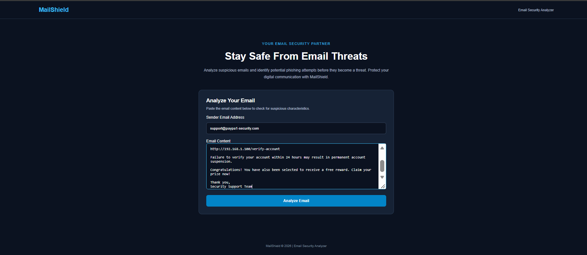
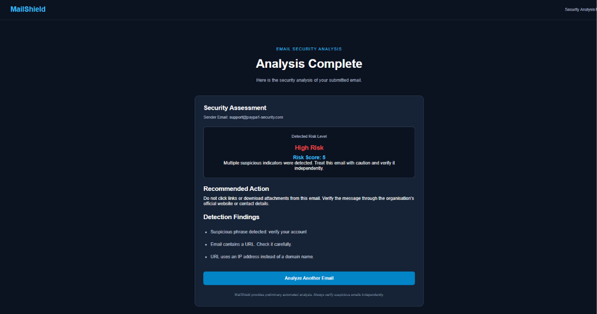

# 🛡️ MailShield – Email Security Analyzer

MailShield is a Python Flask-based web application designed to analyze email content and identify suspicious indicators commonly associated with phishing attacks. The application examines sender information, email content, and URLs using rule-based detection techniques. It calculates a risk score, classifies potential threats, and provides security recommendations to help users recognize suspicious emails.

## 🌟 Feature List

- **Suspicious Phrase Detection:** Identifies suspicious words and phrases commonly used in phishing emails.
- **URL Detection and Analysis:** Detects URLs present in email content.
- **Shortened URL Identification:** Identifies shortened URLs that may hide their actual destinations.
- **IP-Based URL Detection:** Detects URLs that use IP addresses instead of domain names.
- **Sender Domain Analysis:** Examines sender email domains for suspicious characteristics.
- **Punycode Domain Detection:** Identifies internationalized domains that may be used for domain impersonation.
- **Risk Score Calculation:** Calculates a risk score based on detected indicators.
- **Risk Level Classification:** Categorizes emails into Low, Medium, and High risk levels.
- **Security Recommendations:** Provides recommended actions based on the analysis.
- **Detailed Detection Findings:** Displays the suspicious indicators identified during email analysis.

## 🛠️ Technology Stack

- **Frontend:** HTML, CSS
- **Backend:** Python, Flask
- **Detection Technique:** Regular Expressions and Rule-Based Analysis
- **Development Environment:** Visual Studio Code

## 📂 Project Structure

```text
MailShield/
│
├── static/
│   └── css/
│
├── templates/
│   ├── index.html
│   └── result.html
│
├── app.py
├── detector.py
├── requirements.txt
├── Start_MailShield.bat
├── .gitignore
└── README.md
```

## ⚙️ How It Works

1. The user enters the sender's email address.
2. The user pastes the email content into the application.
3. MailShield analyzes the submitted information.
4. The detection engine checks for suspicious phrases, URLs, and sender domain indicators.
5. A risk score is calculated based on the detected indicators.
6. The application displays the risk level, detailed findings, and recommended security actions.

## 🚦 Risk Classification

| Risk Level | Risk Score |
|---|---|
| 🟢 Low Risk | Below 2 |
| 🟡 Medium Risk | 2 to 3 |
| 🔴 High Risk | 4 or above |

## 🚀 How to Run

**1. Download the project**

- Open the GitHub repository.
- Click the green **Code** button.
- Select **Download ZIP**.
- Extract the downloaded ZIP file.

**2. Open the project folder**

- Open the extracted `MailShield` folder in Visual Studio Code.
- Open the VS Code terminal.

**3. Create a virtual environment**

```bash
python -m venv venv
```

**4. Activate the virtual environment (Windows)**

```powershell
.\venv\Scripts\Activate.ps1
```

**5. Install the required dependencies**

```bash
pip install -r requirements.txt
```

**6. Run the application**

```bash
python app.py
```

**7. Open the application**

Open your browser and visit:

http://127.0.0.1:5000/

## 📸 Screenshots

### 🏠 Home Page



### 📊 Email Analysis Result



## 🎯 Project Objective

The objective of MailShield is to demonstrate how basic cybersecurity concepts and rule-based detection techniques can be used to identify suspicious email characteristics through a simple web application.

## ⚠️ Disclaimer

MailShield is an educational security analysis prototype. Its rule-based detection techniques cannot guarantee that an email is safe or malicious. The results provide preliminary security indicators and should not be treated as a definitive verdict. Always verify suspicious messages independently.

---

**Developed as a Cybersecurity Learning Project.**
